# 01 — Crear una API REST proxy desde el API Manager

## Objetivo

Al finalizar este lab, vas a poder crear y publicar una API REST de tipo proxy en IBM API Connect v12 usando el **IBM API Studio** dentro del API Manager. La API va a redirigir las peticiones hacia un servicio backend externo (JSONPlaceholder) mediante una política **Invoke** en el **DataPower API Gateway**.

## Prerrequisitos

- Acceso a una instancia de IBM API Connect v12 con **DataPower API Gateway** configurado.
- Un catálogo **Sandbox** disponible en la organización proveedora.

## Escenario / Contexto

En este lab vas a crear una API proxy que expone el endpoint `/catalog-nn` y redirige las llamadas al servicio `https://148.100.75.105:9443/catalogManager/items?startItemID=10`. El flujo es el siguiente:

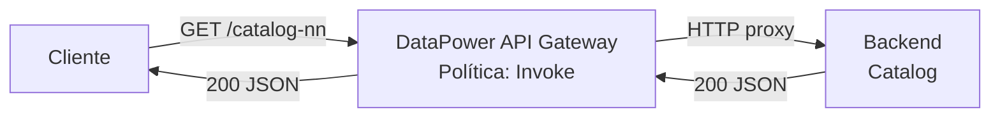

El DataPower API Gateway aplica la política **Invoke** para hacer el reenvío (proxy) hacia el backend, devolviendo la respuesta JSON al cliente que hizo la llamada original.

---

## Pasos

### Paso 1 — Ir al IBM API Studio desde el dashboard

Desde el dashboard del **API Manager**, hacé click en el ícono **API Studio** (lápiz) en la barra lateral izquierda.

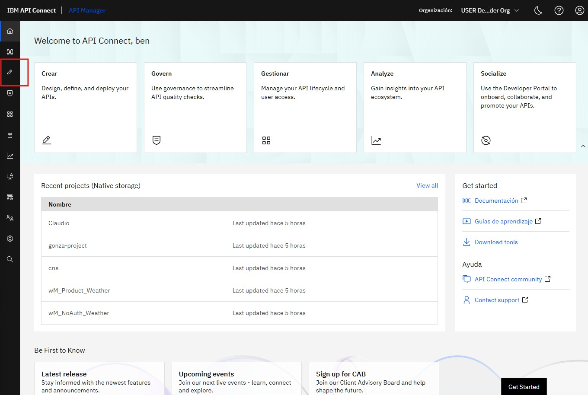

---

### Paso 2 — Crear un nuevo proyecto

> **Nuevo en APIC v12** 
>
> - **Proyectos:** agrupa todos los recursos necesarios para diseñar, publicar y probar una API: definiciones, políticas, entornos y configuraciones de prueba. Se gestiona como una unidad a lo largo de todo el ciclo de vida.

Para crear un nuevo proyecto, hacé click en el botón **New API project** en la esquina superior derecha y elegí la opción **Create blank project**.


Completá los datos del nuevo proyecto:

1. En **Project name**, ingresá un nombre para el proyecto (ej. `mi-primer-proyecto-nn`).
2. Asegurate de que la opción Save to **Native storage** esté seleccionada.
4. Hacé click en **Create**.

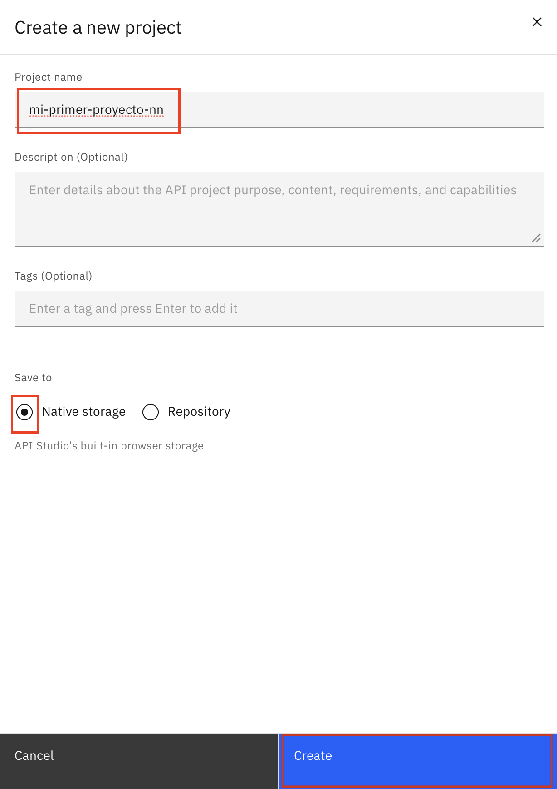

El nuevo proyecto aparecerá primero en la lista. Hacé click sobre el nombre para abrirlo.

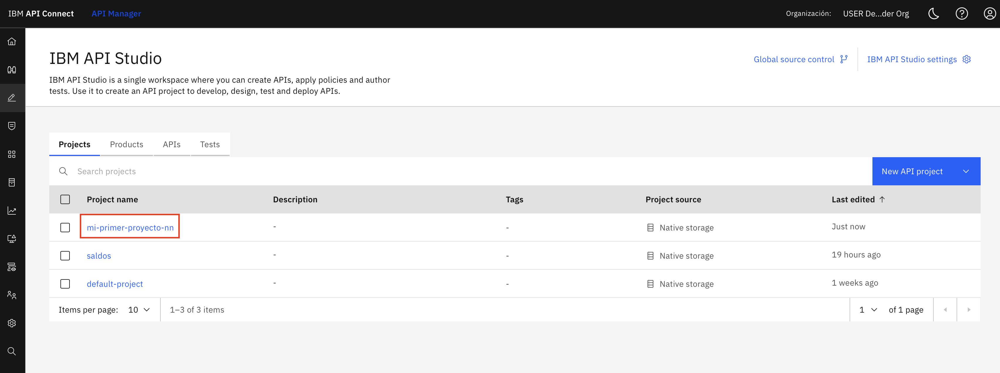

---

### Paso 3 — Agregar una API

Hacé click en **Add an API +** (o en el ícono **+** al lado de **APIs** en el panel Explorer de la izquierda).

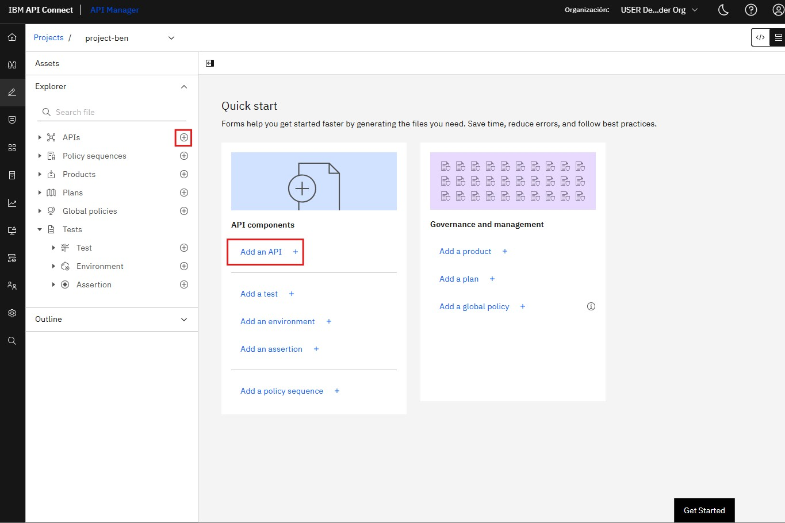


Seleccioná la opción **Create a REST API**.

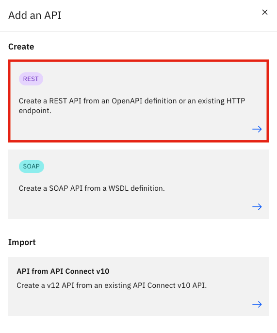


Elegí la opción **From scratch** para crear una API desde cero.

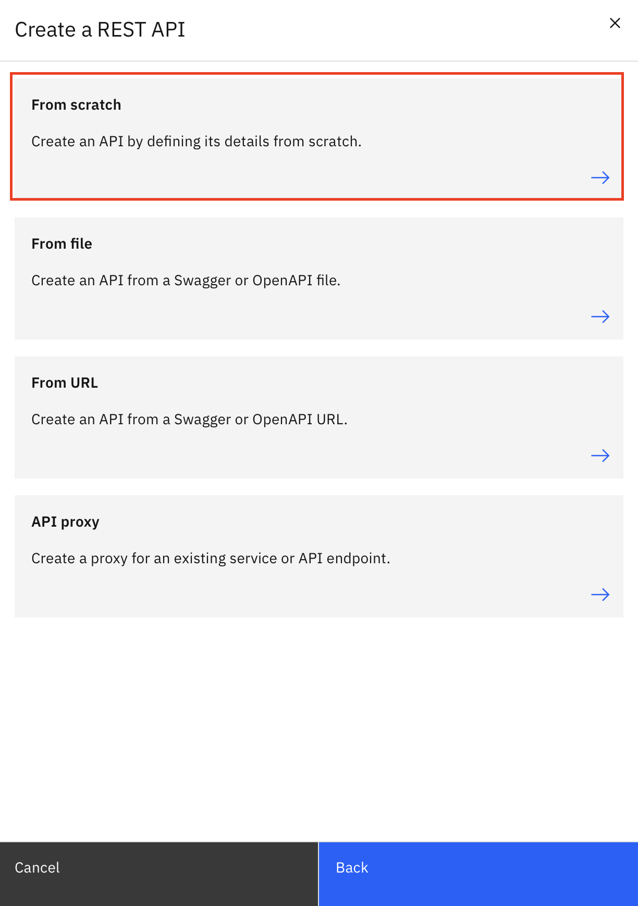

---

### Paso 4 — Completar los datos de tu nueva API

Completá los campos:

1. **API name**: ingresá un nombre descriptivo (ej. `catalog-nn`).
2. **Namespace**: se completa automáticamente con el nombre del proyecto.
3. **API version**: dejá `1.0` (valor por defecto).
4. Hacé click en **Create**.

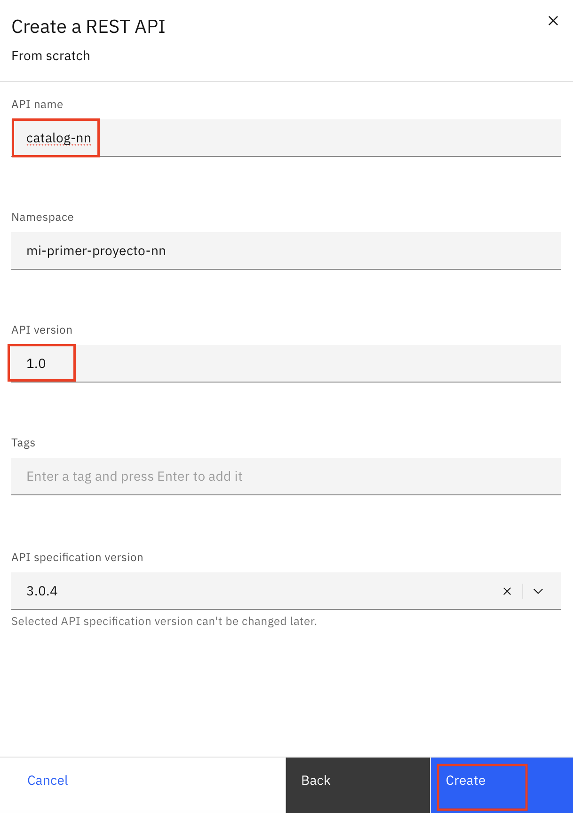

---

### Paso 5 — Diseño de la API: Agregar un path

Se abrirá la nueva vista de edición de la API.

> **Nuevo en APIC v12**
>
> - **Explorer**: muestra todos los assets del proyecto — APIs, policies, tests, assertions y otros recursos relacionados.
> - **Outline**: organiza la estructura de la API en secciones (General information, Paths and Operations, Security, etc.) para navegar y editar su definición de forma ordenada.

En el menú **Outline** de la izquierda, hacé click en **Paths and Operations**. Hacé click en **Add path +**.

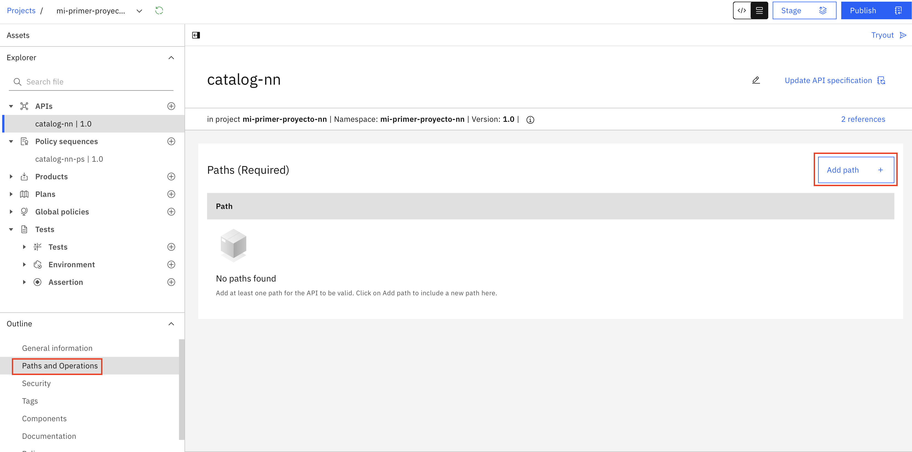

En la formulario **Add path**, completá los campos:

1. En **Path**, ingresá `/catalog-nn`.
2. En **Supported Operations**, marcá **GET**.
3. Opcionalmente, podés incluir un resumen y una descripción de este path. En este caso, dejalo vacío
4. Hacé click en **Add**.


El path `/catalog-nn` aparecerá ahora en la lista de rutas.

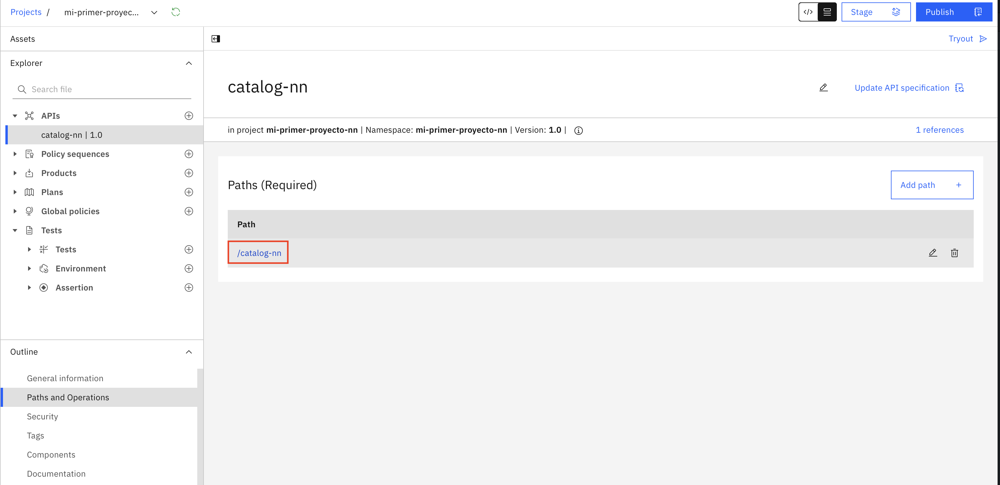

---

### Paso 06 — Agregar una respuesta HTTP a la operación GET

Hacé click sobre el path `/catalog-nn` para ver el detalle de la operación. Scrolleá hasta encontrar la sección **Responses** y hacé click en **Add response** y volvé a elegir la opción **Add response**.

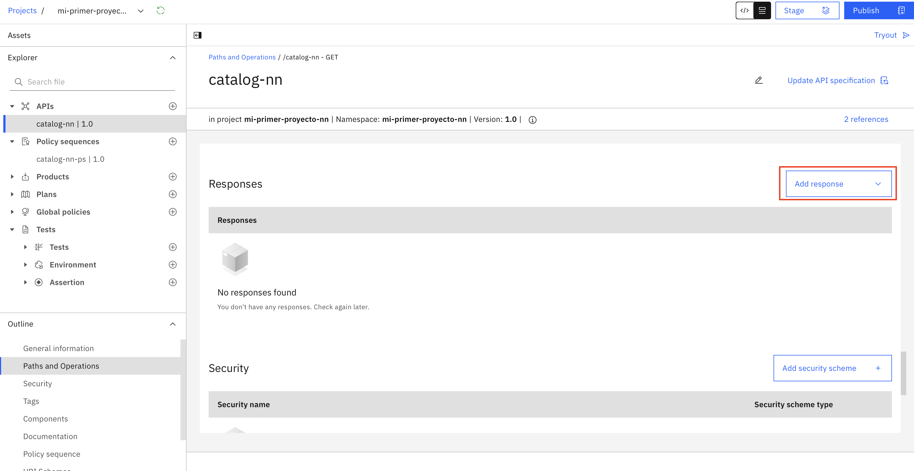

En el modal que se abre, completá:

1. **Status code**: `200`
2. **Description**: `OK`
3. Hacé click en **Add**.

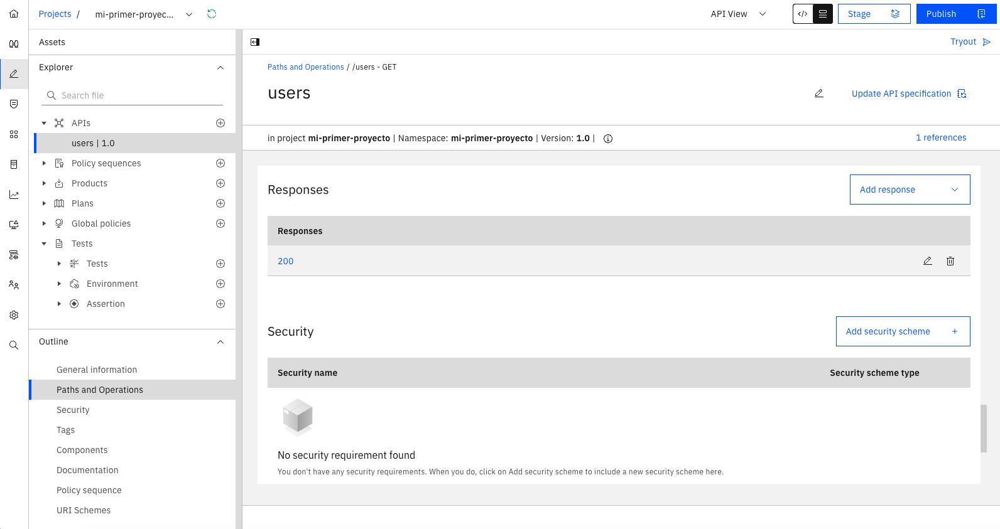

---

### Paso 07 — Crear una Policy Sequence

En el panel **Explorer** de la izquierda, hacé click en el ícono **+** al lado de **Policy sequences**.

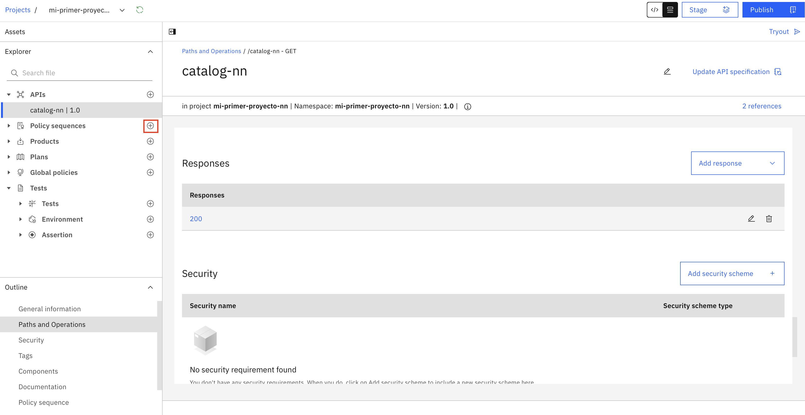

> **Nuevo en APIC v12
>
> — **Policy Sequences:** Definen el orden en que las políticas se aplican a una API durante el procesamiento de requests y responses de las APIs.
>
> El tipo de policy sequence depende del gateway destino:
>
> | Gateway | Tipo | Descripción |
> | --- | --- | --- |
> | DataPower API Gateway | `DataPowerAssembly` | Las políticas se definen como acciones de procesamiento dentro de un ensamblado y se ejecutan en el orden exacto en que fueron configuradas. |
> | DataPower Nano Gateway | `FreeFlowPolicySequence` | Las políticas no están limitadas por etapas predefinidas, permitiendo una definición más flexible y personalizada del orden de ejecución. |
> | webMethods API Gateway | `StagedPolicySequence` | Las políticas se organizan en etapas predefinidas y se ejecutan siguiendo un orden fijo y secuencial. |
>
> En este lab usamos **DataPower API Gateway**, por lo que nuestra policy sequence será de tipo `DataPowerAssembly`.

En el formulario que se abre con el título **Add policy sequence**, completá:

1. **Select Gateway**: seleccioná **DataPower API Gateway**.
2. **Policy sequence name**: ingresá un nombre (ej. `catalog-nn-ps`).
3. **API**: seleccioná la API que creaste (ej. `catalog-nn`).
4. Hacé click en **Add**.

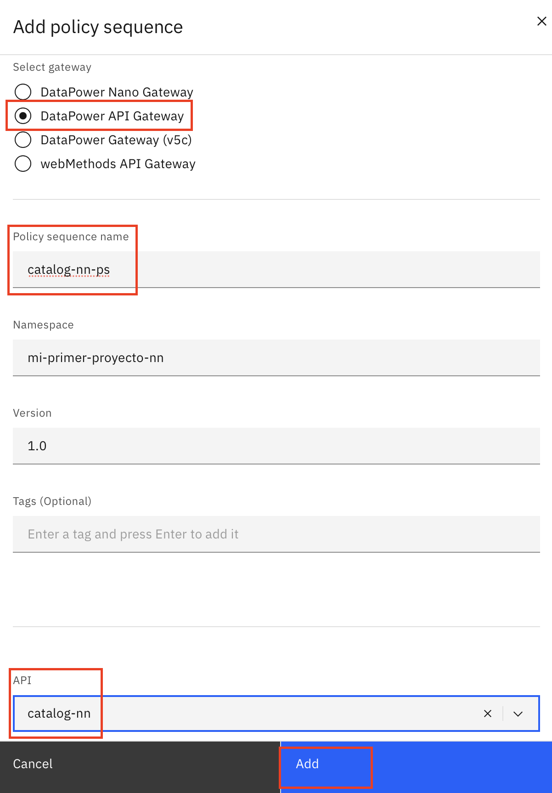

Verás que la nueva policy sequence que creaste, aparecerá como asset en el panel **Explorer** dentro de la sección **Policy sequences**.
---

### Paso 08 — Construir el flujo de ejecución

Al hacer click en la policy sequence que creamos, se abrirá el **Assembly Canvas**  con una política **Invoke** ya creada por defecto y la paleta de políticas disponibles en la parte de abajo. Hacé click sobre el bloque **Invoke** para configurarlo.

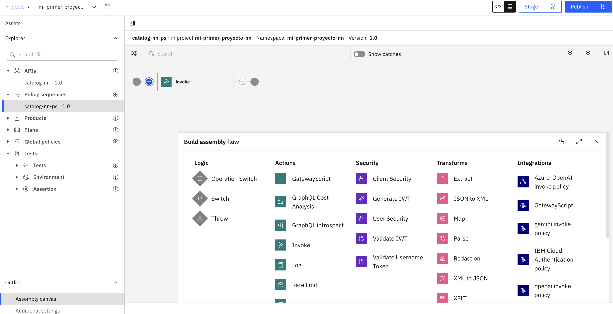

Hacé click sobre la política **invoke** para acceder a sus configuraciones y completá con los siguientes datos:

1. **URL**: ingresá `https://148.100.75.105:9443/catalogManager/items?startItemID=10`
2. **Backend type**: seleccioná `JSON`.

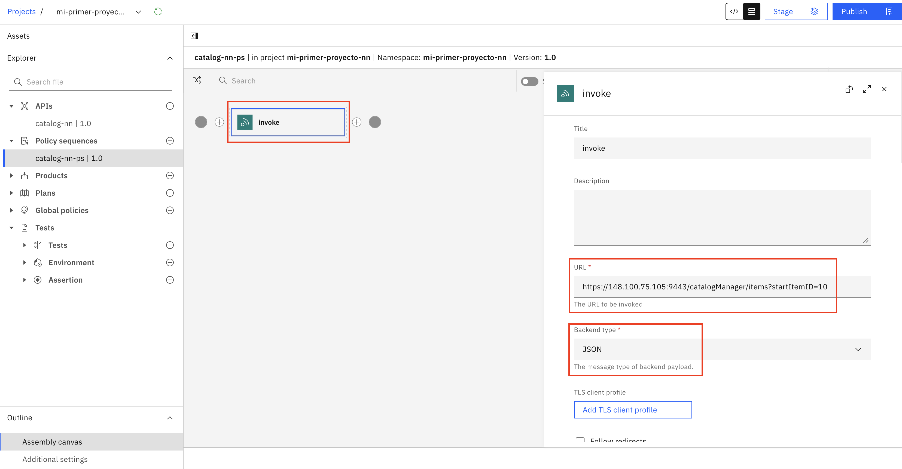

---

### Paso 09 - Publicar la API

Cuando estés listo, hacé click en **Publish** en la barra superior derecha.

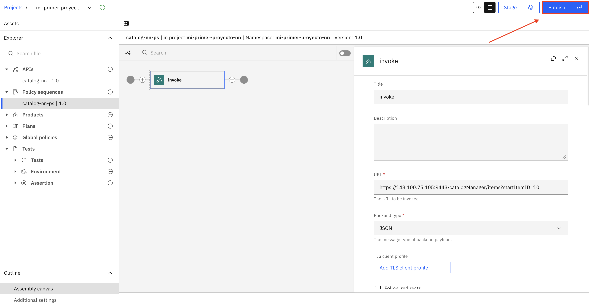

En el formulario que se abre, elegí las siguientes opciones:

1. En **Assets to publish**, dejá la opción **API assets**. 
2. En **Catalog**, asegurate que la opción elegida sea **Sandbox**.
3. En **Available gateways for the selected catalog**, marcá **DataPower API Gateway service**. (y desmarcá el nano-gateway si estuviera tildado)
3. Hacé click en **Next**.

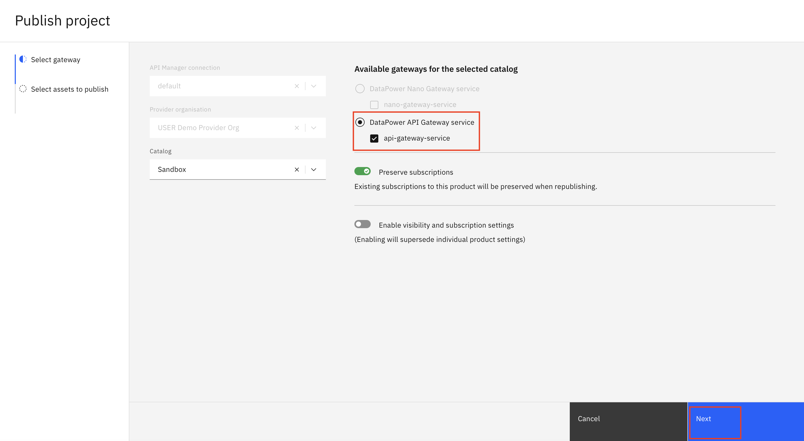

Dejá todos los assets marcados y hacé click en **Publish**.

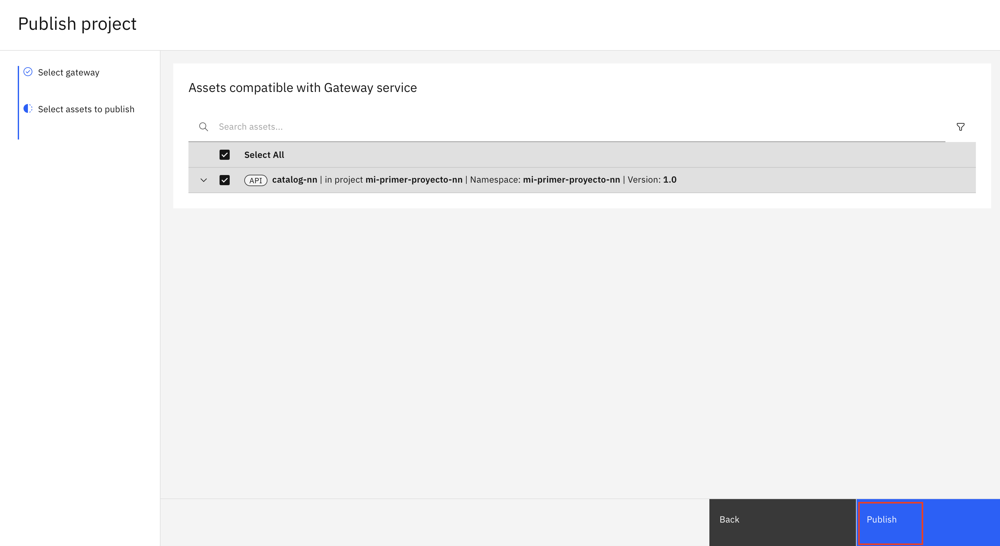

Espera unos segundos hasta que aparezca el mensaje de confirmación.

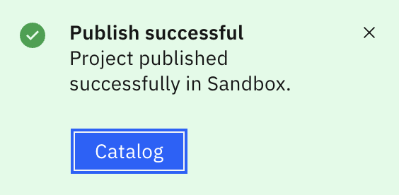

---

### Paso 10 — Probar la API

Volvé a elegir tu API **catalog-nn | 1.0** en el **Explorer** y hacé click sobre el botón **Tryout** que está en la esquina superior derecha. 

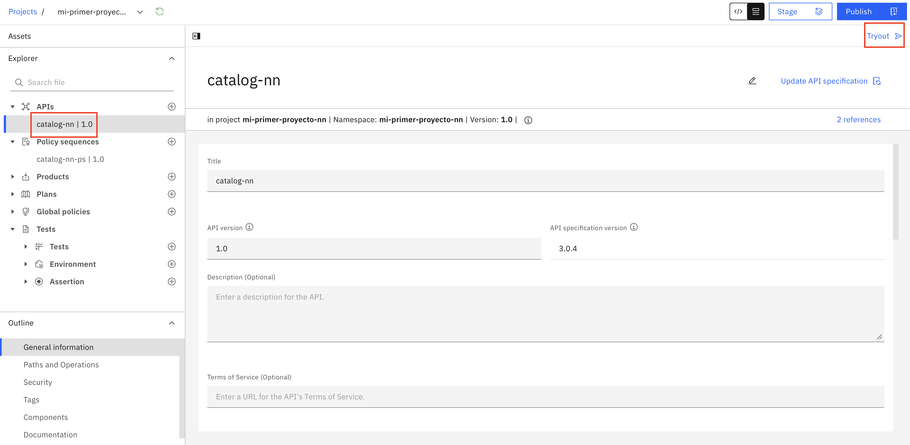

Desplegá la lista **Server** y elegí la opción que termina con `sandbox`. Dejá los demás valores por defecto y presioná el botón **Send**

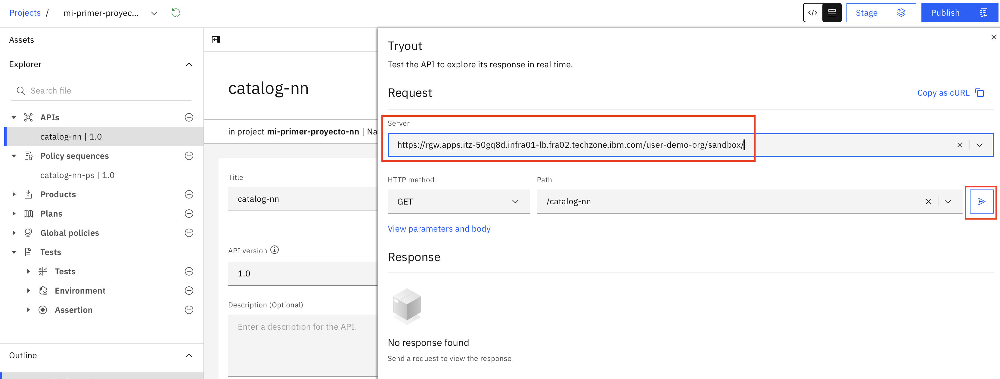

Si todo está correcto, vas a recibir una respuesta JSON con la lista de usuarios del servicio backend. La respuesta siempre incluye el código de estado HTTP y el tiempo que tardó en recibirse una respuesta. Si la llamada se completa (incluso si devuelve un error), la respuesta también incluye los headers y el body.

Hacé click en la pestaña **Body** para ver el cuerpo de la respuesta. Al revisar el cuerpo de la respuesta, hacé click en la pestaña **Parsed** para ver la respuesta formateada o **Raw** para ver el cuerpo de la respuesta sin formato.
Haciendo click en la pestaña **Headers** también vas a poder ver el contenido de los encabezados.

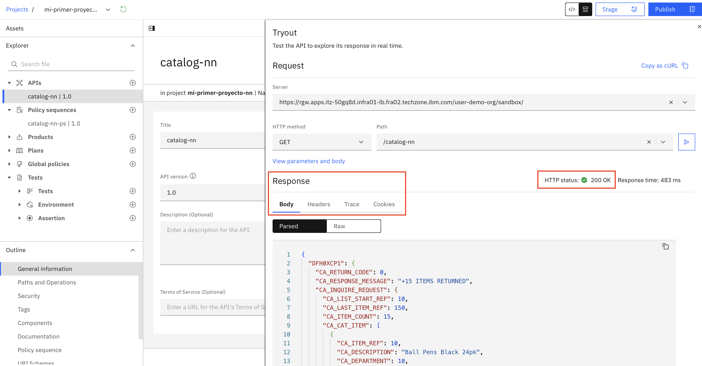

En la pestaña **Trace** podrás ver exactamente cómo se ejecutó la llamada a la API. Esto resulta útil cuando la llamada devuelve un error y no sabes por qué. Podés usarlo para depurar la API revisando el registro de seguimiento para ver cada paso de la ejecución.

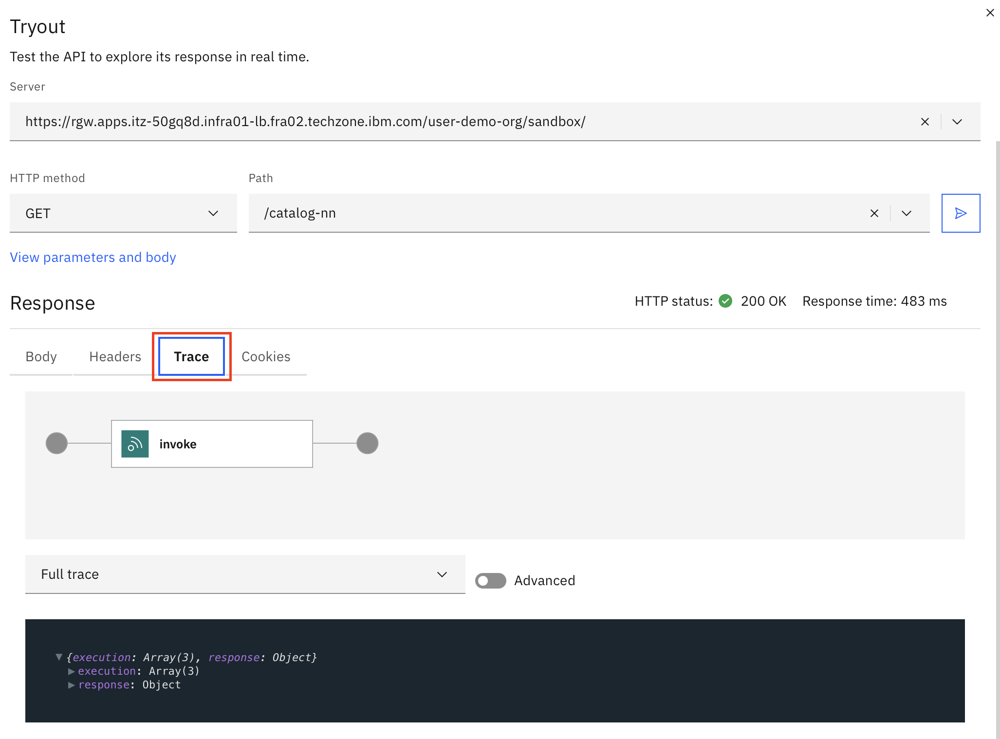

Además, si preferís probarlo desde tu terminal, con el botón **Copy as cURL** que está arriba a la derecha, podrás obtener el comando para ejecutar la misma llamada, por ejemplo:

```text
curl \
  -X GET \
  '<url-base-del-gateway>/dev5237079/sandbox/catalog-nn' \
  -H 'Content-Type: application/json' \
  -H 'Apim-Debug: true'
```  

---

## Verificación

Al finalizar este laboratorio deberías poder:

- [ ] Crear una **API REST que funcione como proxy** a un backend no segurizado.
- [ ] Publicarla en **IBM DataPower API Gateway**.
- [ ] Probarla desde el **API Studio** o tu terminal y recibir una respuesta JSON válida con la lista de usuarios.

## Recursos adicionales

- [IBM API Connect — Documentación oficial](https://www.ibm.com/docs/en/api-connect/software)
- [API outline overview](https://www.ibm.com/docs/en/api-connect/software/12.1.1?topic=view-api-outline-overview)
- [Política Invoke en DataPower API Gateway](https://www.ibm.com/docs/en/api-connect/software/12.1.1?topic=invoke-configuring-policy-datapower-api-gateway)
